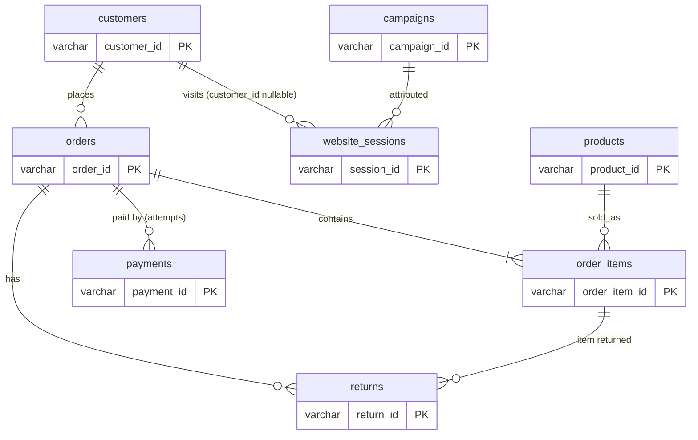
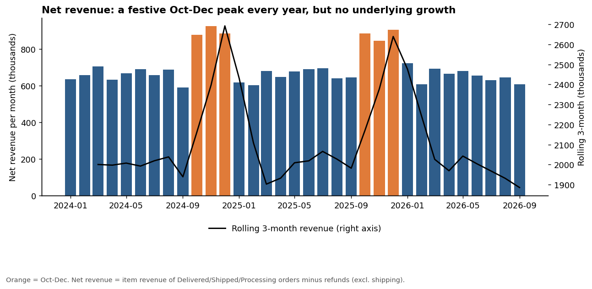
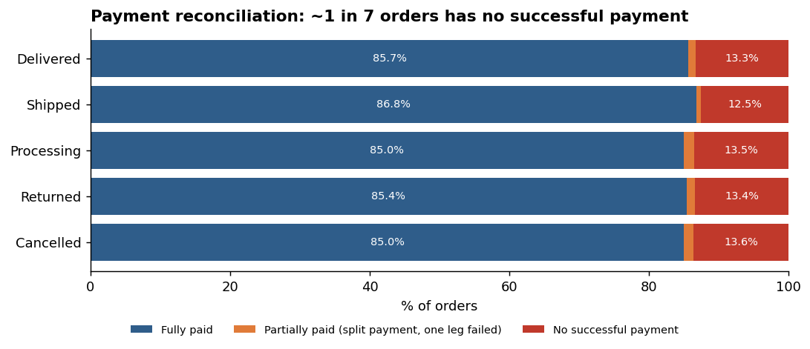
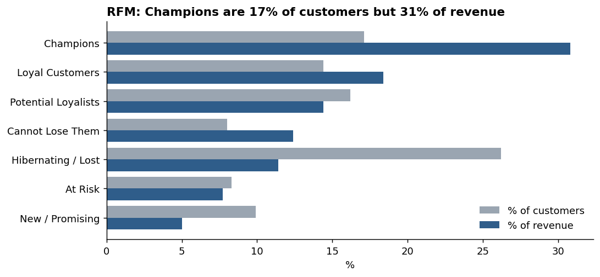
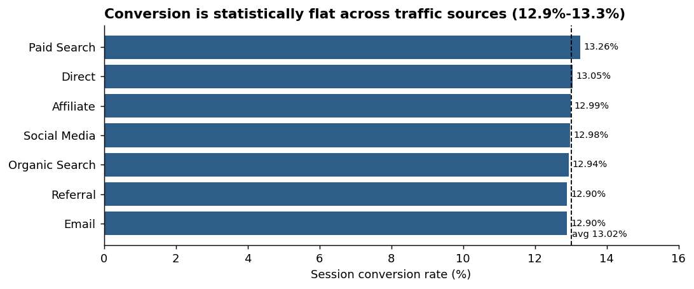
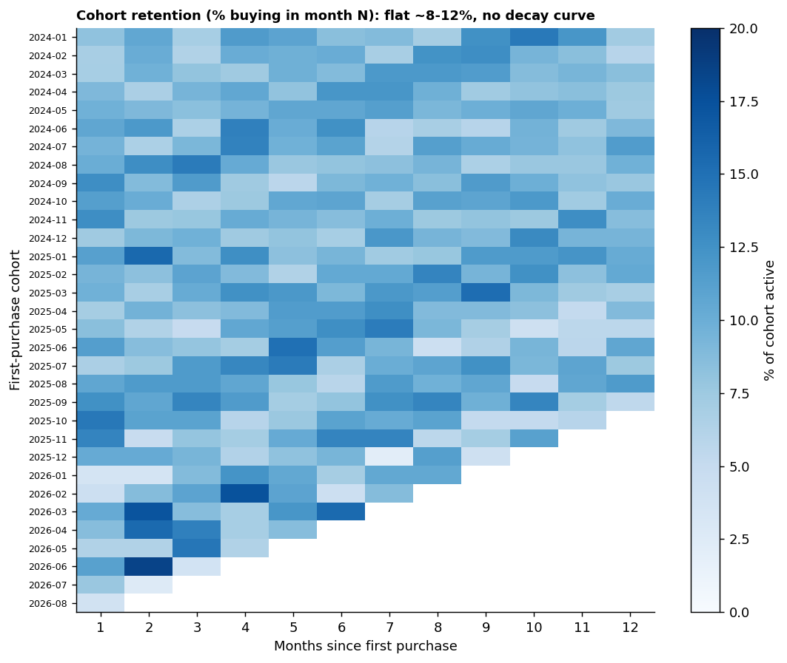

# E-commerce Business Performance & Customer Analytics (SQL Server)

End-to-end SQL analysis of a **synthetic** e-commerce business (8 related tables, ~200k rows) written as if supporting a commercial analytics team: data-quality audit → clean staging layer → KPI definitions → 30 business questions → evidence-backed insights and recommendations.

> ⚠️ **The dataset is synthetic** (generated for portfolio practice). It contains deliberate data-quality issues and contains no real customer or company data. Findings describe this dataset only.

---

## 1. Headline numbers (Jan 2024 – Sep 2026, 33 months)

| KPI | Value |
|---|---|
| Orders booked / revenue orders | 30,000 / 25,744 |
| Gross item sales (list value) | 25.81M |
| Discounts given | 2.22M (8.6% of gross) |
| **Net item revenue** (excl. shipping) | **23.59M** |
| Refunds on revenue orders | 0.51M (2.1%) |
| **Net revenue after refunds** | **23.08M** |
| Gross margin (pre-refund) | 36.5% |
| Average order value (incl. shipping) | ~948 |
| Cancellation rate | 7.9% of orders |
| Customers / purchasing customers | 8,000 / 7,660 |
| Repeat purchase rate | 86.9% (avg 3.4 orders per buyer) |
| Session conversion rate | 13.0% (70,000 sessions) |

*Currency is not stated in the data, so values are shown as plain numbers.*

---

## 2. Repository structure

```
├── data/                      8 raw CSVs (synthetic)
├── sql/
│   ├── 00_setup_schema_and_load.sql   create DB + tables, BULK INSERT the CSVs
│   ├── 01_data_quality.sql            Q1-Q5  profiling, integrity, reconciliation
│   ├── 00b_staging_views.sql          cleaning views + KPI definitions (run right after 00)
│   ├── 02_revenue_operations.sql      Q6-Q15
│   ├── 03_customer_analytics.sql      Q16-Q22
│   ├── 04_marketing_analytics.sql     Q23-Q27
│   ├── 05_advanced_sql.sql            Q28-Q30 (DENSE_RANK, recursive CTE, LAG, rolling window, cohorts)
│   └── run_all.sql                    runs everything in order (SQLCMD mode)
├── results/                   one CSV per query tag (e.g. Q06.csv) + validation_checks.csv
├── images/                    charts used below
├── scripts/
│   ├── validate_with_pandas.py   independent re-computation of headline KPIs
│   └── make_charts.py            builds the charts from /results
└── README.md
```

## 3. How to run

1. Install SQL Server 2017+ (Developer/Express is fine) and SSMS or Azure Data Studio.
2. Put this repo's `data/` folder where the **server** can read it and edit `@DataPath` in `00_setup_schema_and_load.sql`.
   *(Alternative: SSMS → Tasks → Import Flat File, one table per CSV, same table names.)*
3. Run in order: `00` → `00b` → `01` → `02` … `05` (or open `run_all.sql` in SQLCMD mode).
4. Every query block is tagged `-- [Q06]`, `-- [Q19a]` … and matches a file in `results/`.

Optional (Python 3.9+): `pip install -r requirements.txt`, then `python scripts/validate_with_pandas.py` and `python scripts/make_charts.py`.

---

## 4. Data model



Grain: one row per customer / order / order line / payment **attempt** / returned item / session / campaign / product. Order-level amounts are never summed after joining to lines or payments — they are pre-aggregated in `vw_order_summary` (one row per order) to avoid fan-out.

---

## 5. KPI definitions (encoded once in `00b_staging_views.sql`)

| KPI | Definition |
|---|---|
| **Revenue order** | `order_status IN ('Delivered','Shipped','Processing')`. *Cancelled* = no sale. *Returned* = whole order came back. |
| **Gross item sales** | `SUM(quantity × unit_price)` |
| **Net item revenue** | `SUM(quantity × unit_selling_price)` on revenue orders (shipping excluded). Reconciles to `orders.item_subtotal` for 100% of orders. |
| **Refunds** | `returns.refund_amount` (capped at line revenue), deducted only for revenue orders so a *Returned* order is never double counted. |
| **Net revenue** | Net item revenue − refunds |
| **Gross profit / margin** | Net item revenue − `quantity × unit_cost_at_sale`; margin = profit ÷ revenue (pre-refund) |
| **AOV** | Average `order_total` over revenue orders (includes shipping) |
| **Cash collected** | `SUM(payment_amount)` where `payment_status = 'Successful'` |
| **Cancellation rate** | Cancelled ÷ all orders |
| **Return rate (order)** | Orders with status *Returned* or a returns row ÷ Delivered + Returned orders |
| **Repeat purchase rate** | Customers with ≥ 2 revenue orders ÷ customers with ≥ 1 |
| **Conversion rate** | Sessions with `converted = 'Yes'` ÷ sessions |
| **Analysis date** | `MAX(order_date)` = 2026-09-30 (never `GETDATE()`) |

---

## 6. Data-quality findings (Q1–Q5, `01_data_quality.sql`)

| Check | Result |
|---|---|
| Duplicate primary keys / orphan foreign keys | **0 / 0** – grain and relationships hold |
| NULL / unknown values | 25 customer cities, 20 order states (repaired from the city→state mapping), 18 `unknown` acquisition channels, 9,132 anonymous sessions |
| Order lines with quantity = 0 | 6 (zero revenue; excluded from unit counts) |
| Negative `discount_pct` | 6 lines. 4 of them carry a real discounted selling price, so revenue is taken from `unit_selling_price`, **not** recomputed from the corrupt discount field |
| Return quantity > purchased quantity | 28 rows (all 2 returned vs 1 bought) – capped in the staging view |
| Return dates after the last order date (2026-09-30) | 24 (8 are later than 12 Oct 2026) |
| Negative session durations | 50 – set to NULL for duration averages |
| Orders placed **before** the customer's signup date | **8,501 (28%)** – `signup_date` is unreliable, so no signup-based tenure analysis is done |
| Same product on two lines of one order | 76 order/product pairs |
| Payment reconciliation | 25,691 orders fully paid · 321 partially paid · **3,988 with no successful payment** (see insight 2) |
| `Returned` status vs `returns` table | 1,883 orders are *Returned* but only 131 have a returns row; 1,604 *Delivered* orders have return rows → two systems of record disagree |
| Sessions dated before their campaign start | 24,665 of 70,000; 59,528 sessions have a traffic source that differs from the campaign's channel → **campaign attribution is unreliable** |

---

## 7. Key insights

### Insight 1 – The business is seasonal but not growing
Oct–Dec order volume runs **+37%** above the other months every year, yet like-for-like Jan–Sep net revenue is flat: **6.06M (2024) → 6.04M (2025) → 6.04M (2026)**. The rolling 3-month line returns to the same ~2.0M baseline every year; 2026 order count is +1.4% but revenue is +0.1%, i.e. volume without value growth.



### Insight 2 – ~1 in 7 orders has no successful payment (revenue-assurance risk)
**3,988 orders (13.3%) have no successful payment row, worth 3.74M.** The gap is not confined to open orders: **3,035 *Delivered* orders (13.2% of delivered order value, 2.86M)** have no successful payment, and **2,050 *Cancelled* orders still hold 1.92M of successful payments** (refund liability). A further 321 orders are partially paid after one leg of a split payment failed. The rate is identical across order statuses (~85–87% fully paid), which points to a systematic payment-capture or data-feed issue rather than business behaviour. *(This is a hypothesis to investigate – the dataset cannot say which.)*



### Insight 3 – More than half the base has gone quiet, and a high-value group is at risk
72% of customers have not bought in 90 days and **53.5% (4,276) not in 180 days**, even though the repeat rate is 87% — customers buy about once every ~6 months (average gap 190–196 days across segments). RFM scoring shows **Champions are 17% of customers but 31% of revenue**, while the **"Cannot Lose Them" + "At Risk" groups (1,249 customers, 16% of base) hold 20% of revenue** with 390–450 days since their last order. Revenue is moderately concentrated: the top 10% of customers generate 25% of revenue, the top 20% generate 42%.



### Insight 4 – The CRM "VIP / Regular / New / At Risk" labels do not predict behaviour
Average lifetime value is 2,887 for *VIP*, 2,946 for *Regular*, 2,883 for *New* and 2,735 for *At Risk*; repeat rates (81–84%) and purchase gaps (192–196 days) are almost identical, and 54% of VIPs are inactive for 180+ days. The labels are not acting as a usable targeting variable. Breadth of purchase *is* informative: customers who bought from 5+ categories average 3,200–6,400 lifetime revenue vs 463 for single-category buyers (association, not proof of cause – frequent buyers naturally touch more categories).

### Insight 5 – Marketing metrics are flat, so the data cannot yet guide spend
Conversion is 12.9–13.3% for **every** traffic source (χ² = 0.9 on 6 df, no significant difference), device conversion is 13.0–14.0%, and payment-method success is 85.6–87.0% (not significant). Landing pages show the only visible spread – *Blog* 14.3% vs *Sale* 12.4% – but it is not statistically significant (χ² = 9.1 on 5 df, p ≈ 0.11). Campaigns each receive ~1,700–1,800 attributed sessions **regardless of budget (13.8k to 493k; correlation −0.20)**, and 35% of sessions pre-date their campaign. Budget per attributed conversion is therefore driven almost entirely by budget size and must **not** be read as ROI (the data has no spend-to-order link).



### Other observations
* **Margin and mix are uniform:** category gross margin 34.2–38.6% (Beauty 38.5%, Sports 38.6% highest); channel margin 36.4–36.5%; no channel under- or over-performs on AOV (937–956).
* **State rankings reflect city count, not demand:** Maharashtra (3 cities) = 20.3% of revenue and Odisha (2 cities) = 13.5%, while single-city states sit at ~6.5–7% each – revenue per city is essentially flat.
* **Returns:** ~two-thirds of returns cite reasons the business controls – Late Delivery 18.1%, Damaged 17.7%, Wrong Item 15.7%, Not as Described 15.4%. Item-level return rates are ~2.2–2.5% across all categories.
* **Cohort retention is flat (~8–12% buy in any given month after the first purchase) with no decay curve**, consistent with the long, steady purchase gaps in insight 3.



---

## 8. Recommendations

1. **Stand up a payment-reconciliation control (highest priority).** Report weekly: delivered orders with no successful payment (3,035 / 2.86M), cancelled orders holding cash (2,050 / 1.92M) and partially paid orders (321). Investigate whether this is a capture failure or a missing data feed, then auto-refund cancelled orders.
2. **Run a targeted win-back programme instead of broad acquisition.** Start with RFM *Cannot Lose Them* and *At Risk* (1,249 customers, 20% of revenue); use the marketing-opt-in flag to size the reachable audience (e.g. 1,100+ opted-in *Regular* customers inactive 180+ days) and A/B test against a holdout. Measure with the cohort retention view.
3. **Focus growth levers on the Oct–Dec peak and on purchase frequency.** Flat Jan–Sep revenue means the seasonal peak is the only visible lever; test pre-festive reactivation 4–6 weeks ahead and category cross-sell prompts (Beauty–Electronics–Grocery is the most common pair).
4. **Fix measurement before reallocating marketing spend.** Enforce campaign start/end validation, store UTM/campaign on the order, and rebuild segments on RFM rather than the current CRM labels. Until then, treat conversion differences between sources as noise.
5. **Reduce controllable returns.** Late delivery, damage and wrong item account for ~52% of returns; add carrier SLA tracking and pick/pack QA, and reconcile the `Returned` order status with the `returns` table (1,752 returned-status orders have no return record, so refund exposure is currently unknowable).

---

## 9. Question → query map

| # | Question | File · block |
|---|---|---|
| 1 | Row counts, date ranges, duplicate PKs, NULL rates | 01 · Q01a–d |
| 2 | Orders with missing customers | 01 · Q02a–b |
| 3 | Unknown products / invalid qty, price, discount | 01 · Q03a–c |
| 4 | Payment reconciliation | 01 · Q04a–e |
| 5 | Return quantity > purchased | 01 · Q05a–d |
| 6 | Monthly orders, sales, discounts, shipping, AOV | 02 · Q06, Q06b |
| 7 | Status mix by month and channel | 02 · Q07a–b |
| 8 | Payment success by method | 02 · Q08 |
| 9 | Top 10 products (units, revenue) | 02 · Q09a–b |
| 10 | Category revenue, profit, margin | 02 · Q10 |
| 11 | Revenue and margin by channel and state | 02 · Q11a–b |
| 12 | High-value orders and segment concentration | 02 · Q12a–c |
| 13 | Cancellation and return rates (month, channel, category, state) | 02 · Q13a–d |
| 14 | Return reasons and category return rates | 02 · Q14a–b |
| 15 | Weekday / month patterns | 02 · Q15a–b |
| 16 | New vs repeat customers by month | 03 · Q16 |
| 17 | Customer rankings by LTV and payments | 03 · Q17, Q17b |
| 18 | Repeat rate and time between purchases | 03 · Q18a–d |
| 19 | RFM segmentation | 03 · Q19a |
| 20 | Inactive customers (90/180 days) | 03 · Q20a–b |
| 21 | Acquisition channel vs LTV | 03 · Q21, Q21b |
| 22 | Multi-category customers | 03 · Q22a–b |
| 23 | Sessions, conversion, duration by source/device | 04 · Q23a–c |
| 24 | Conversion by landing page and campaign | 04 · Q24a–c |
| 25 | Campaign budget vs sessions/conversions (not ROI) | 04 · Q25, Q25b |
| 26 | High engagement / low conversion sources | 04 · Q26, Q26b |
| 27 | First-order behaviour by acquisition channel | 04 · Q27a–b |
| 28 | Rank products within category (`DENSE_RANK`) | 05 · Q28 |
| 29 | Calendar CTE / months with zero orders | 05 · Q29a–b |
| 30 | MoM growth, rolling 3-month, cohort retention | 05 · Q30a–c |

---

## 10. Validation & method notes

* **Independent re-computation.** `scripts/validate_with_pandas.py` recomputes 15 headline numbers directly from the raw CSVs (not from the SQL views) and compares them with the query outputs: revenue totals by month / category / channel / state, refunds, cash collected, row counts, repeat rate, RFM totals, conversion rate, cohort size. **All 15 match exactly** (`results/validation_checks.csv`).
* **Grain controls.** Order-level amounts come from `vw_order_summary` (one row per order, 30,000 = `orders`); line-level analysis uses `vw_item_outcomes` (65,570 = `order_items`). Customer revenue is pre-aggregated before joining to line data.
* **Raw data is never modified**; cleaning lives in views and is documented in `00b_staging_views.sql`.
* Result CSVs were generated by executing the same query logic in a SQLite harness (only the handful of date functions were mechanically translated) and cross-checked with pandas. Scripts are written for SQL Server 2017+.

## 11. Limitations

* Synthetic data: relationships such as flat conversion and uniform margins reflect how the data was generated and may not hold in real data.
* "New" customers in the first months of 2024 are overstated (no purchase history before Jan 2024); 2026 cohorts are still maturing, so their later-month retention is blank rather than zero.
* No delivery timestamps exist, so weekday analysis describes order *placement* only.
* Item-level returns (2.4% of units) and order-status returns (6.3% of orders) disagree; both are reported and labelled.
* Gross profit uses `unit_cost_at_sale` and excludes shipping cost, returns handling and marketing spend.

## 12. Skills demonstrated

SQL Server · joins and grain control · CTEs · window functions (`ROW_NUMBER`, `RANK`, `DENSE_RANK`, `NTILE`, `LAG`, rolling frames) · recursive CTE calendar · staging views · cohort & RFM analysis · data-quality auditing · KPI definition · Python (pandas/matplotlib) for validation and charts.
